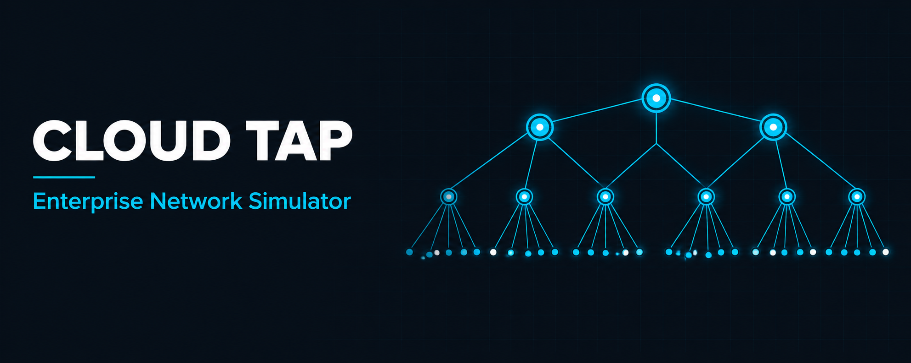
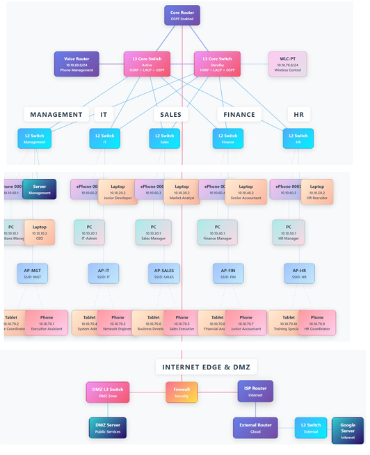
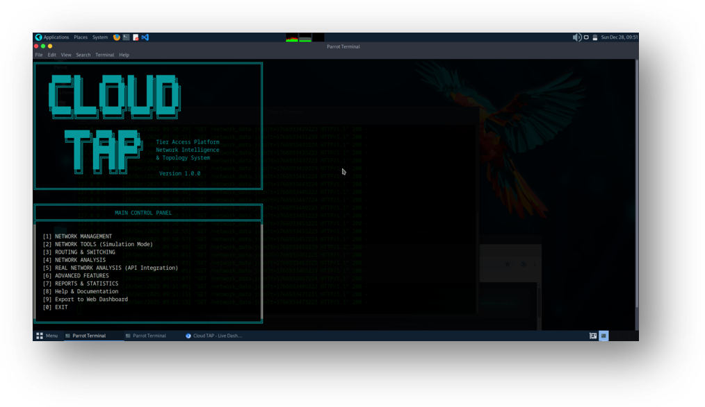
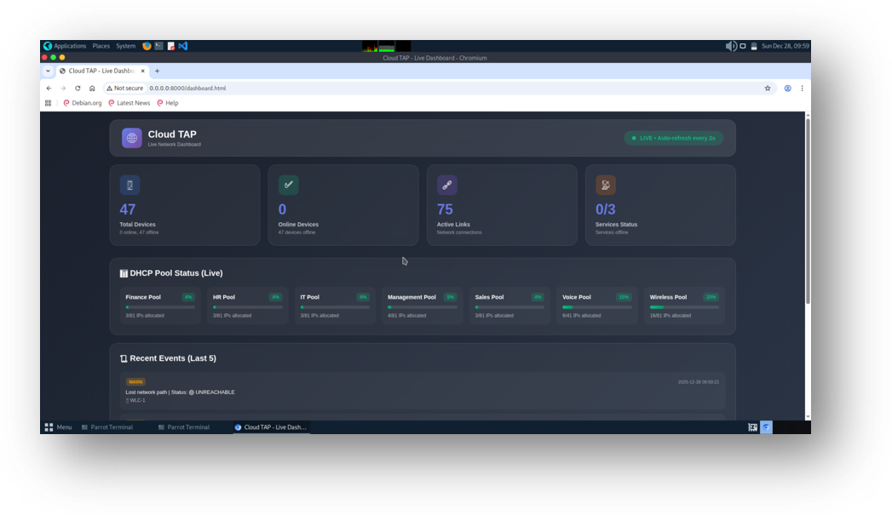
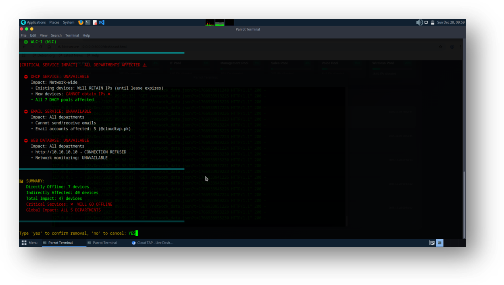
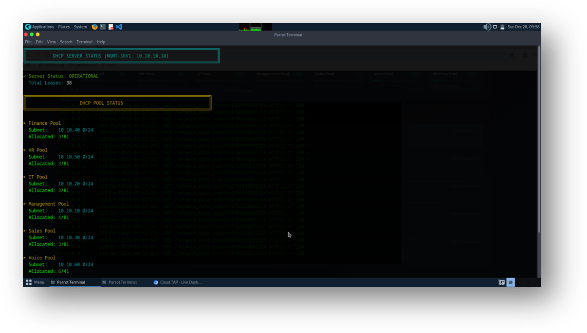

<p align="center">
  
</p>

<h1 align="center">Cloud TAP — Enterprise Network Simulator</h1>

<h3 align="center">Data structures and graph algorithms applied to real network operations</h3>

<p align="center">
  
  
  
  
</p>

<p align="center">
  <a href="#overview"><b>Overview</b></a> ·
  <a href="#two-versions"><b>Versions</b></a> ·
  <a href="#simulated-network"><b>Network</b></a> ·
  <a href="#data-structures"><b>Data Structures</b></a> ·
  <a href="#algorithms"><b>Algorithms</b></a> ·
  <a href="#interface"><b>Interface</b></a> ·
  <a href="#performance"><b>Performance</b></a> ·
  <a href="#build--run"><b>Build</b></a> ·
  <a href="#team"><b>Team</b></a>
</p>

---

## Overview

**Cloud TAP (Tier Access Platform)** is a C++ network simulator that models an enterprise network and uses data structures and graph algorithms to handle the problems of running it: finding devices, allocating IP addresses, calculating paths, tracing the impact of failures and ranking events by severity.

It was built as a Data Structures course project and comes in two versions: a small prototype (**Mini**) and the full 48-device system (**Full**).

| Operational problem | Approach |
| ------------------- | -------- |
| Find a device among hundreds | Balanced search tree — `O(log n)` lookup |
| Calculate the best route | BFS for fewest hops, Dijkstra for lowest latency |
| Assign IP addresses without conflicts | DHCP pools backed by ordered sets and queues |
| Know what fails when a device goes down | DFS impact analysis over the connection graph |
| Surface critical events first | Severity-ranked event logging |

## At a Glance

| | |
| --- | --- |
| **Network** | 48 devices · 5 departments · 75 links · 7 DHCP pools |
| **Protocols modelled** | OSPF, HSRP, NAT, VLANs, firewall ACLs, DHCP, Syslog |
| **Interface** | Console control panel and a live web dashboard |
| **Codebase** | 3,000+ lines of C++ |
| **Validation** | Test cases for normal operation, edge cases, error handling and dynamic events · memory checked with valgrind |

## Two Versions

| | **Cloud TAP Mini** | **Cloud TAP Full** |
| --- | --- | --- |
| **Purpose** | Prototype of the core data structures | Complete enterprise simulation |
| **Devices** | 9 | 48 |
| **Data structures** | Custom BST, graph, queue, stack, priority queue | STL containers: `map`, `set`, `deque`, `vector`, `queue` |
| **Algorithms** | BFS, DFS, Dijkstra | BFS, DFS, ACL matching, NAT translation |
| **Protocols** | — | OSPF, HSRP, NAT, VLANs, firewall ACLs, DHCP, Syslog |
| **Interface** | Console menu | Console control panel and web dashboard |
| **Report** | 16 pages | 27 pages |

Both reports and the technical write-up are in [`Cloud-Tap/`](./Cloud-Tap).

## Simulated Network

<p align="center">
  <a href="./images/structure.png">
    
  </a>
</p>

<p align="center"><sub>Click the image to open it full size.</sub></p>

The topology is hierarchical, with a redundant core, one switch per department and a security perimeter.

| Layer | Devices | Function |
| ----- | ------- | -------- |
| **Core** | CORE-R1, L3-ACTIVE, L3-STANDBY | High-speed backbone routing with HSRP failover |
| **Internet Edge** | ISP-R1, FW-1, EXT-R1, EXT-L2, GOOGLE-SRV | WAN connectivity and security |
| **DMZ** | DMZ-L3, DMZ-SRV | Public-facing services |
| **Services** | VOICE-R1, WLC-1 | VoIP and wireless management |
| **Distribution** | One L2 switch per department | Department aggregation |
| **Access** | PCs, laptops, IP phones, tablets, mobile phones, access points | End users |

Each of the five departments — Management, IT, Sales, Finance and HR — has an L2 switch, an IP phone with PC pass-through, a desktop PC, a laptop, an access point, a tablet and a mobile phone.

| Subnet | Use |
| ------ | --- |
| 10.10.10.0/24 | Management |
| 10.10.20.0/24 | IT |
| 10.10.30.0/24 | Sales |
| 10.10.40.0/24 | Finance |
| 10.10.50.0/24 | HR |
| 10.10.60.0/24 | Voice |
| 10.10.70.0/24 | Wireless |

**Protocol behaviour**

| Protocol | What is simulated |
| -------- | ----------------- |
| **OSPF** | Neighbour discovery with 10 s hello and 40 s dead timers; routes use static configuration |
| **HSRP** | Active and standby L3 core switches with automatic failover |
| **NAT** | Translation table, reverse lookup and 5-minute entry timeout |
| **VLANs** | Per-department segmentation |
| **Firewall ACL** | 8 rules, first-match policy, CIDR-aware matching |
| **DHCP** | 7 pools of 81 addresses each |
| **Syslog** | 1,000-entry circular buffer with severity levels |

## Data Structures

**Full version — STL as the backbone**

The goal was to master data-structure concepts and algorithms, not to rewrite containers. STL provides the containers; the traversal, allocation and matching logic is our own.

| Structure | Used for | Complexity |
| --------- | -------- | ---------- |
| `map<string, Device>` (red-black tree) | Device registry with sorted iteration | `O(log n)` |
| `set<int>` | Used IPs per DHCP pool, duplicate prevention | `O(log m)` |
| `deque<SyslogEntry>` | Circular event buffer | `O(1)` at both ends |
| `vector<Connection>` | Adjacency list for a sparse graph | `O(degree)` |
| `queue<string>` | FIFO order for BFS | `O(1)` |
| `set<string>` | Visited set for DFS and cycle detection | `O(log n)` |

**Mini version — structures built per problem**

| Structure | Used for |
| --------- | -------- |
| Binary search tree (`DeviceBST`) | Device storage with sorted listing |
| Graph (`NetworkGraph`) | Weighted adjacency list (latency) |
| Queue (`DHCPQueue`) | FIFO allocation from an 81-address pool |
| Stack (`ConnectionStack`) | Last 20 connections, newest first |
| Priority queue (`EventLogger`) | Max-heap ordering by severity |

**Key design decisions**

| Decision | Reason |
| -------- | ------ |
| `map` over `unordered_map` | Topology views need sorted output; lookup is fast either way at this scale |
| Adjacency list over matrix | The graph is sparse (6.6% density): 75 edges instead of a 48 × 48 matrix of 2,304 cells |
| `deque` over a hand-written circular array | Avoids manual index wrapping and iterator problems |

## Algorithms

| Algorithm | Purpose | Complexity | Example |
| --------- | ------- | ---------- | ------- |
| **BFS** | Shortest path by hop count | `O(V + E)` | MGMT-PC1 → MGMT-SW1 → CORE-R1 → SALES-SW1 → SALES-PC1 (5 hops) |
| **DFS** | Cascading failure and impact analysis | `O(V + E)` | Removing MGMT-SW1: 7 devices lose their link directly, 40 are affected indirectly |
| **Dijkstra** | Minimum-latency path over weighted links | `O((V + E) log V)` | IT-PC1 → SALES-PC1 (Mini) |
| **ACL matching** | First-match firewall decision | `O(R)` | FIN-PC1 → 8.8.8.8 over ICMP is denied by rule 41 |
| **NAT translation** | Private-to-public mapping | `O(n)` | 10.10.10.1 → 203.0.113.102 |

When a device is removed, the impact report also lists the enterprise services that go down (DHCP, email, web) and asks for confirmation before applying the change.

## Interface

The simulator runs from a console control panel with ten options:

| | |
| --- | --- |
| **1** Network Management | **6** Advanced Features |
| **2** Network Tools (simulation mode) | **7** Reports & Statistics |
| **3** Routing & Switching | **8** Help & Documentation |
| **4** Network Analysis | **9** Export to Web Dashboard |
| **5** Real Network Analysis (API integration) | **0** Exit |

| Module | Features |
| ------ | -------- |
| **Device search** | By ID, IP address, name, department, type, or multiple filters |
| **Network tools** | Ping, traceroute, IP configuration, netstat, ARP table, history, firewall rules |
| **Network analysis** | Health dashboard, DHCP utilisation, bottleneck detection, device distribution, traffic patterns, security posture, combined report |
| **Web dashboard** | Total and active devices, links, services, live DHCP pool status and the latest events |

| | |
| --- | --- |
|  |  |
| <sub>Console control panel</sub> | <sub>Live web dashboard</sub> |
|  |  |
| <sub>Device removal impact analysis</sub> | <sub>DHCP server status</sub> |

## Performance

Measured on the 48-device network.

| Operation | Time | Complexity |
| --------- | ---- | ---------- |
| Device lookup / add | 0.02 ms | `O(log n)` |
| Syslog insert | 0.01 ms | `O(1)` |
| ACL check (ping) | 0.08 ms | `O(R)` |
| DHCP allocation | 0.15 ms | `O(log m)` |
| DFS dependents | 1.0 ms | `O(V + E)` |
| BFS path finding | 1.2 ms | `O(V + E)` |
| Device removal with impact analysis | 1.5 ms | `O(V + E)` |
| Traceroute | 2.5 ms | `O(H × R)` |

| Scale | Devices | Memory |
| ----- | ------- | ------ |
| Current | 48 | ~260 KB |
| Tested | 100 | ~520 KB |
| Estimated | 1,000 | ~5 MB |

Memory grows linearly with the number of devices, and no leaks were found with valgrind.

## Engineering Challenges

| Challenge | Cause | Fix |
| --------- | --------- | --- |
| CIDR matching in ACLs | Rules needed /8, /16, /24 and /30 prefixes | Prefix-aware subnet matching |
| Crash after 1,000 log entries | Unbounded deque growth | Fixed-size circular buffer |
| Segmentation fault after removing a device | Connections still pointed to the removed node | Clean up both directions of every link |
| Crash when a DHCP pool ran out | No availability check before allocating | Pre-check, error log and an empty result |
| BFS failed across network segments | Unreachable target not handled | "No route found" instead of an empty path |
| Duplicate device IDs corrupted the tree | Insert did not check for existing keys | Search before insert, log an error |
| INFO events shown before CRITICAL | Comparator built a min-heap | Reversed comparator for a max-heap |

## Build & Run

```bash
git clone https://github.com/abdul-wahid022/enterprise-network-simulator.git
cd enterprise-network-simulator/Cloud-Tap
g++ -std=c++17 -O2 -o cloud-tap cloud.cpp
./cloud-tap
```

## Repository Structure

```
enterprise-network-simulator/
├── README.md
├── images/              # banner, topology and interface screenshots
└── Cloud-Tap/           # source code, reports and technical write-up
    └── README.md
```

## Team

Data Structures course project, December 2025.

| Member | Contribution |
| ------ | ------------ |
| **Abdul Wahid** | Network topology design, binary search tree, connection stack, system integration, testing |
| **Uneeb Ali** | DHCP queue, graph and traversal algorithms (BFS, DFS, Dijkstra), priority-queue event logger, complexity analysis |

## Future Enhancements

- Self-balancing BST (AVL or red-black) for the custom tree in the Mini version
- Persistent storage for network configurations
- Full OSPF route calculation with Dijkstra instead of static configuration
- Performance testing on larger networks
- Multi-threading for 1,000+ device simulations

## License

Developed as a university course project and shared for educational reference.

## Contact

<p align="center">
  <b>Abdul Wahid</b>
</p>

<p align="center">
  <a href="mailto:a.wahid7860668@gmail.com"></a>
  <a href="https://www.linkedin.com/in/abdul-wahid022"></a>
  <a href="https://github.com/abdul-wahid022"></a>
</p>

<p align="center">
  If this repository helped you, consider starring it.
</p>
